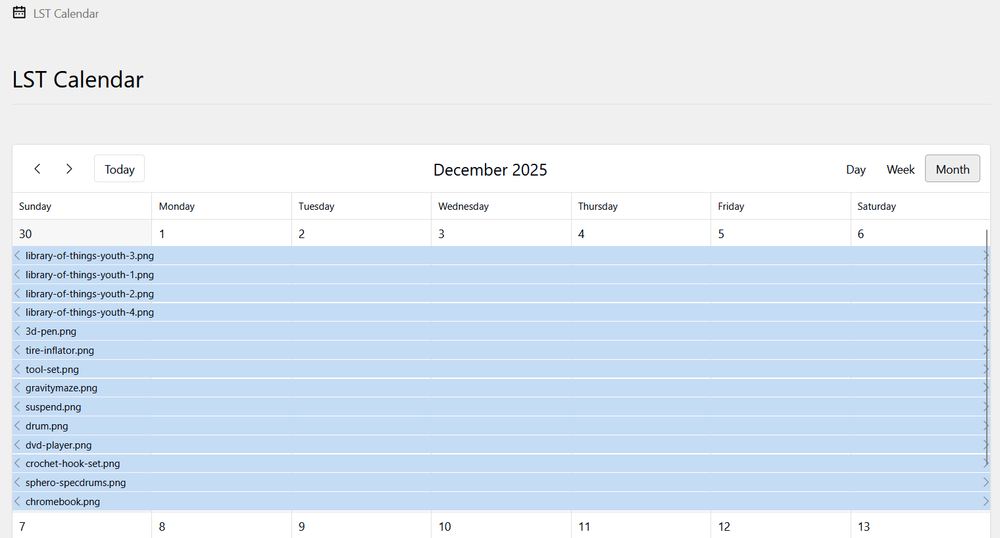
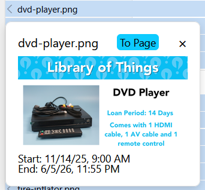

# LST Calendar

A plugin for [LibSignTool](https://github.com/salinapl/LibSignTool). Adds an area to the Kirby CMS panel to give editors an overview of all active LST slides and events. Editors can click on calendar events to bring up a summary. They can then click a link to go directly to the LST slide or event panel page.

## Screenshots



## Getting Started

### Dependencies
A Kirby CMS website installation with the following requirements:
* [LibSignTool](https://github.com/salinapl/LibSignTool)
* Kirby CMS v6 or newer
* Vue3

### Installing
* **Manual:** Download the zip and extract into your site/plugins folder
* **Composer:** ```composer require salinapl/libsigntool```
* **Git Submodule install:** ```git submodule add https://github.com/salinapl/lst-calendar.git site/plugins/lst-calendar```

### Executing program
Open a bash console and navigate to the lst-calendar folder. Run these commands to install dependencies and build the project:
```
npm install
npm run build
```
> [!NOTE]
> Building the project creates the index.css and index.js in the plugins root directory.

> [!WARNING]
> Failure to build the plugin will cause the application to not load anything.

## Customizing the Calendar

The calendar should be fully customizable, as long as you don't touch anything to do with events. To get an idea of all possibilities, you can view [FullCalendar's Demo](https://fullcalendar.io/demos)

### Theme
The current theme shipped with the plugin is FullCalendar's ***Forma*** theme in ***blue***. When changing the theme and color, you need to verify the following:

**LstCalendar.vue:** The stylesheet import for the theme and palette are correct.
**calendarController.js:** The "themePlugin" import references the correct theme.

>[!IMPORTANT]
>Some styles are not a part of the theme. Example: The "To Page" button's background. Those styles can be changed at the bottom of the **LstCalendar.vue** file.

### Calendar Display

There are many ways the calendar can be displayed to editors. If you want to fine tune how the calendar looks, you can read up on [FullCalendar's documentation](https://fullcalendar.io/docs). Most modifications will be made in the ***return*** for the **useCalendarController** function in the **calendarController.js** file.

>[!CAUTION]
>Do not modify anything that deals with **events**. If you do, then the calendar may break.

## Authors

* [Nkitchen86](https://github.com/nkitchen86)

## Version History

* 1.0.0
    * Initial Release

## License

### Released under MIT License

Copyright (c) 2026 Salina Public Library

Permission is hereby granted, free of charge, to any person obtaining a copy of this software and associated documentation files (the "Software"), to deal in the Software without restriction, including without limitation the rights to use, copy, modify, merge, publish, distribute, sublicense, and/or sell copies of the Software, and to permit persons to whom the Software is furnished to do so, subject to the following conditions:

The above copyright notice and this permission notice shall be included in all copies or substantial portions of the Software.

THE SOFTWARE IS PROVIDED "AS IS", WITHOUT WARRANTY OF ANY KIND, EXPRESS OR IMPLIED, INCLUDING BUT NOT LIMITED TO THE WARRANTIES OF MERCHANTABILITY, FITNESS FOR A PARTICULAR PURPOSE AND NONINFRINGEMENT. IN NO EVENT SHALL THE AUTHORS OR COPYRIGHT HOLDERS BE LIABLE FOR ANY CLAIM, DAMAGES OR OTHER LIABILITY, WHETHER IN AN ACTION OF CONTRACT, TORT OR OTHERWISE, ARISING FROM, OUT OF OR IN CONNECTION WITH THE SOFTWARE OR THE USE OR OTHER DEALINGS IN THE SOFTWARE.

## Acknowledgments

Documentation
* [Kirby CMS](https://getkirby.com/docs/guide/quickstart)
* [Vue3](https://vuejs.org/guide/introduction.html)
* [FullCalendar](https://fullcalendar.io/docs)